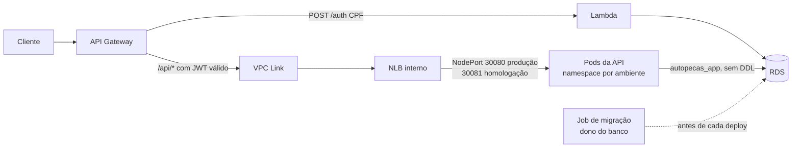

# 🔧 Oficina Mecânica — Sistema de Gestão de Ordens de Serviço (MVP)

> Back-end do sistema integrado de atendimento e execução de serviços para uma oficina mecânica de médio porte. Permite gerenciar clientes, veículos, ordens de serviço, orçamentos, peças e funcionários, com acompanhamento em tempo real e autorização de reparos via aplicativo.

Desenvolvido como parte do **Tech Challenge — FIAP 16SOAT**.

---

## 📑 Índice

- [Stack Tecnológica](#-stack-tecnológica)
- [Arquitetura e Design](#-arquitetura-e-design)
- [Estrutura do Projeto](#-estrutura-do-projeto)
- [Modelo de Domínio](#-modelo-de-domínio)
- [Segurança e autenticação](#segurança-e-autenticação)
- [Endpoints da API](#-endpoints-da-api)
- [Infraestrutura e execução](#infraestrutura-e-execução)
  - [Docker Compose](#docker-compose)
  - [Kubernetes local](#kubernetes-local)
- [Deploy na AWS (Fase 3)](#️-deploy-na-aws-fase-3)
  - [Ambientes](#ambientes)
  - [Como o deploy funciona](#como-o-deploy-funciona)
  - [Deploy automático](#deploy-automático)
- [CI/CD Local (Self-hosted Runner)](#-cicd-local-self-hosted-runner)
  - [Como funciona o pipeline](#como-funciona-o-pipeline)
  - [Pré-requisitos da máquina](#pré-requisitos-da-máquina)
  - [Instalar o GitHub Actions Runner](#instalar-o-github-actions-runner)
  - [Registrar o runner no repositório](#registrar-o-runner-no-repositório)
  - [Iniciar o runner](#iniciar-o-runner)
  - [Secret necessário](#secret-necessário)
  - [Executar o pipeline manualmente](#executar-o-pipeline-manualmente)
  - [Verificar o runner no GitHub](#verificar-o-runner-no-github)
- [Testes e Cobertura](#-testes-e-cobertura)
- [Análise de Qualidade (SonarQube)](#-análise-de-qualidade-sonarqube)
- [Variáveis de ambiente](#variaveis-de-ambiente)
- [Diagramas](#-diagramas)

---

## 🛠 Stack Tecnológica

| Categoria                    | Tecnologia                                              |
|------------------------------|---------------------------------------------------------|
| Linguagem                    | Java 21 (LTS)                                           |
| Framework                    | Spring Boot 4.0.6                                       |
| Gerenciador de Dependências  | Maven 3.9+                                              |
| Banco de Dados               | PostgreSQL 16                                           |
| Migração de Schema           | Flyway                                                  |
| Autenticação / Autorização   | Lambda RS256 + Spring Security OAuth2 Resource Server    |
| Mapeamento de Objetos        | MapStruct 1.5.5.Final + Lombok 1.18.38                  |
| Documentação da API          | Springdoc OpenAPI UI (Swagger) 3.0.3                    |
| Testes                       | JUnit 5 + Testcontainers (PostgreSQL real)              |
| Fronteiras de Arquitetura    | ArchUnit 1.3.0 (10 regras, quebram a build)             |
| Cobertura de Código          | JaCoCo 0.8.12 (mínimo 80% de linhas)                   |
| Análise de Qualidade         | SonarQube (Community Edition)                           |
| Containerização              | Docker (build em 3 estágios) + Docker Compose           |
| Orquestração                 | Kubernetes — Deployments, Services, ConfigMap/Secrets, HPA |
| Infraestrutura como Código   | Terraform (kind + PostgreSQL + metrics-server)          |

---

## 📐 Arquitetura e Design

A aplicação segue **Arquitetura Hexagonal (Ports & Adapters)** com **Domain-Driven Design**. A
regra que organiza tudo é a **direção da dependência**: ela aponta sempre para dentro.

```
                     ┌──────────────────────────────────────┐
                     │            ADAPTERS (fora)           │
   HTTP / JWT ──┤  adapter/in/web                      │
                     │      ↓ chama inbound port            │
                     │  ┌────────────────────────────────┐  │
                     │  │      APPLICATION (casos de uso) │  │
                     │  │  port/in  ·  usecase  ·  port/out│  │
                     │  │  ┌──────────────────────────┐   │  │
                     │  │  │    DOMAIN (Java puro)    │   │  │
                     │  │  │ agregados · VOs · regras │   │  │
                     │  │  └──────────────────────────┘   │  │
                     │  └────────────────────────────────┘  │
                     │      ↑ implementa outbound port      │
   PostgreSQL ───────┤  adapter/out/persistence · clock ·   │
                     │  numbering · tx                      │
                     └──────────────────────────────────────┘
```

```bash
javac -d /tmp/dominio $(find src/main/java/com/autopecas/autopecas/domain -name "*.java")
```

**Princípios aplicados:**
- **Ports & Adapters:** 9 inbound ports e 16 outbound ports. A aplicação
  declara o que precisa; quem implementa é sempre um adapter.
- **Modelos ricos e encapsulados:** construtores privados, factory methods (`abrir`, `criar`,
  `reconstituir`), coleções imutáveis e **nenhum setter público** — a regra de negócio não pode
  ser burlada de fora.
- **Value Objects imutáveis:** `CPF`, `CNPJ`, `Placa`, `Endereco` como Java records, validando no
  construtor.
- **Referências entre agregados por id**, não por objeto — o que elimina o acoplamento a
  lazy-loading do Hibernate.
- **Persistência separada do domínio:** as entidades JPA (`*JpaEntity`) vivem no adapter, e
  mappers escritos à mão convertem nos dois sentidos.
- **Tempo e numeração como ports:** `Relogio` e `GeradorNumeroOS`/`GeradorMatricula`. O domínio
  nunca chama `LocalDateTime.now()` — recebe o instante por parâmetro, o que torna as regras
  determinísticas.
- **Transação como port:** `Transacao` (implementada com `TransactionTemplate`). Nenhum caso de
  uso conhece `@Transactional`.
- **Paginação própria:** `PaginaRequisicao`/`Pagina` atravessam as ports; `Pageable`/`Page` do
  Spring ficam confinados ao adapter web, que remonta o envelope JSON original.
- **CQRS-lite nas leituras:** listagens e dashboard usam *query ports* com projeção SQL, evitando
  o N+1 que existiria ao carregar agregados só para ler nome do cliente e placa.
- **Fronteiras verificadas por ArchUnit:** 10 regras que quebram a build se alguém furar o
  hexágono (ver `arquitetura/ArquiteturaHexagonalTest`).

---

## 📂 Estrutura do Projeto

```
src/main/java/com/autopecas/autopecas/
├── AutopecasApplication.java
│
├── domain/                          # ZERO dependências — nem framework, nem Lombok
│   ├── model/
│   │   ├── cliente/                 # Cliente (abstrato), ClientePF, ClientePJ
│   │   ├── funcionario/             # Funcionario (abstrato), Atendente, Mecanico
│   │   ├── veiculo/                 # Veiculo
│   │   ├── os/                      # OrdemServico (raiz), ItemServicoOS, ItemPecaOS,
│   │   │                            #   HistoricoStatusOS
│   │   ├── orcamento/               # Orcamento (raiz), ItemOrcamentoServico, ItemOrcamentoPeca
│   │   └── estoque/                 # Peca, Servico, MovimentacaoEstoque
│   ├── vo/                          # CPF, CNPJ, Placa, Endereco (records)
│   ├── enums/                       # 7 enums do negócio
│   ├── exception/                   # BusinessException, ResourceNotFound, EstoqueInsuficiente
│   └── service/                     # MovimentadorDeEstoque (domain service puro)
│
├── application/                     # Depende SÓ de domain + JDK
│   ├── port/in/                     # 9 inbound ports + commands aninhados
│   │   └── view/                    # Projeções de leitura (records)
│   ├── port/out/                    # Repositórios, query ports, Relogio, geradores, Transacao, Notificador
│   ├── pagination/                  # PaginaRequisicao, Pagina
│   └── usecase/                     # 9 casos de uso, sem anotação de framework
│
├── adapter/
│   ├── in/web/                      # Controllers REST, DTOs, mappers MapStruct, handler de erro
│   └── out/
│       ├── persistence/             # entity/ (JPA), repository/ (Spring Data), mapper/,
│       │                            #   adapter/ (implementa as ports), projection/
│       ├── clock/                   # RelogioSistema
│       ├── numbering/               # Geradores sobre sequences do Postgres
│       └── tx/                      # TransacaoSpring
│
├── config/                          # UseCaseConfig (wiring), SecurityConfig, OpenApiConfig
└── security/                        # LambdaJwtAuthConverter, PropriedadeDoRecurso

src/test/java/com/autopecas/autopecas/
├── arquitetura/                     # ArquiteturaHexagonalTest — fronteiras como teste
├── domain/                          # Testes puros: sem Spring, sem mocks, sem banco
├── application/
│   ├── fake/                        # Fakes das ports (TransacaoDireta, RelogioFixo, geradores)
│   └── usecase/                     # Testes de caso de uso contra dublês das ports
└── integration/                     # Testcontainers + PostgreSQL real (schema via Flyway)
```

Infraestrutura (detalhada nas seções [Infraestrutura e execução](#infraestrutura-e-execução) e [Deploy na AWS](#️-deploy-na-aws-fase-3)):

```
Dockerfile                           # build em 3 estágios, JAR em camadas
docker-compose.yml                   # stack local; SonarQube atrás do profile `qa`


infra/
├── k8s/                             # aplicado com `kubectl apply -f infra/k8s/`
│   ├── 00-namespace.yaml
│   ├── 10-configmap-app.yaml        # configuração não sensível
│   ├── 11-secret-app.yaml           # credenciais (valores de desenvolvimento)
│   ├── 30-app-deployment.yaml       # Deployment + Service + NodePort + PDB
│   └── 40-app-hpa.yaml              # HPA: CPU 70% / memória 85%, 2–5 réplicas
│
└── terraform/                       # provisiona o que precede a aplicação
    ├── versions.tf                  # providers kind, kubernetes, helm
    ├── cluster.tf                   # cluster kind + namespace
    ├── database.tf                  # PostgreSQL (StatefulSet + PVC + Service)
    ├── metrics-server.tf            # pré-requisito do HPA
    ├── variables.tf / outputs.tf
    └── terraform.tfvars.example
```

---

## 🗂 Modelo de Domínio

### Entidades Principais

| Entidade               | Descrição                                                    |
|------------------------|--------------------------------------------------------------|
| `Cliente`              | Abstrato — base para PF e PJ                                 |
| `ClientePF`            | Cliente Pessoa Física (CPF)                                  |
| `ClientePJ`            | Cliente Pessoa Jurídica (CNPJ)                               |
| `Veiculo`              | Veículo cadastrado (placa, modelo, ano)                      |
| `Funcionário`          | Abstrato — base para Atendente e Mecânico                    |
| `Atendente`            | Funcionário responsável pelo atendimento                     |
| `Mecanico`             | Funcionário executor dos serviços                            |
| `OrdemServico`         | OS com ciclo de vida completo e histórico de status          |
| `HistoricoStatusOS`    | Registro de cada transição de status da OS                   |
| `Orcamento`            | Orçamento vinculado a uma OS                                 |
| `ItemOrcamentoPeca`    | Peça incluída em um orçamento                                |
| `ItemOrcamentoServico` | Serviço incluído em um orçamento                             |
| `ItemPecaOS`           | Peça efetivamente utilizada na OS                            |
| `ItemServicoOS`        | Serviço efetivamente executado na OS                         |
| `Peca`                 | Peça do estoque (com controle de quantidade mínima)          |
| `Servico`              | Serviço disponível no catálogo                               |
| `MovimentacaoEstoque`  | Registro de entrada/saída de peças                           |

### Value Objects

| Value Object | Descrição                                     |
|--------------|-----------------------------------------------|
| `CPF`        | Validação e formatação de CPF                 |
| `CNPJ`       | Validação e formatação de CNPJ                |
| `Placa`      | Validação de placa (padrão Mercosul e antigo) |
| `Endereco`   | Endereço completo                             |

### Enumerações

| Enum                      | Valores                                                    |
|---------------------------|------------------------------------------------------------|
| `StatusOS`                | `RECEBIDA`, `EM_DIAGNOSTICO`, `AGUARDANDO_APROVACAO`, `EM_EXECUCAO`, `FINALIZADA`, `ENTREGUE` |
| `StatusOrcamento`         | `RASCUNHO`, `ENVIADO`, `APROVADO`, `REJEITADO`             |
| `StatusItemOS`            | `PENDENTE`, `EM_EXECUCAO`, `CONCLUIDO`                     |
| `TipoCliente`             | `PF`, `PJ`                                                 |
| `TipoFuncionario`         | `ATENDENTE`, `MECANICO`                                    |
| `Genero`                  | `MASCULINO`, `FEMININO`, `OUTRO`                           |
| `TipoMovimentacaoEstoque` | `ENTRADA`, `SAIDA`                                         |

---

## Segurança e autenticação

A aplicação recebe JWT RS256 emitido pela Lambda e valida issuer, JWKS,
audience, validade, api:access, perfil e roles. Não depende de um Identity
Provider em container. A chave privada fica somente na Lambda.

- Clientes: POST /auth com CPF/CNPJ; perfil CLIENTE, sub=UUID do cliente.
- Funcionarios: POST /auth/funcionarios com CPF; perfil FUNCIONARIO.
- Roles de funcionários: ADMIN, ATENDENTE e MECANICO, atribuidas no banco.
- Clientes só acessam seus recursos e não recebem privilégios administrativos.

Configure JWT_ISSUER, JWT_JWKS_URI e JWT_AUDIENCE conforme o ambiente.
Cole o JWT em Authorize > BearerAuth no Swagger. Probes de saúde continuam
públicas na rede interna. As APIs de negócio exigem JWT e preservam @PreAuthorize.

Detalhes, concessão de permissões e migração:
[autenticação sem Keycloak](docs/autenticacao-lambda.md).

## 🌐 Endpoints da API

A documentação interativa completa está disponível via Swagger após subir a aplicação:

> **Swagger UI:** `http://localhost:8080/swagger-ui.html`  
> **OpenAPI JSON:** `http://localhost:8080/v3/api-docs`

### Clientes — `/api/clientes`

| Método   | Endpoint                        | Roles                            | Descrição                          |
|----------|---------------------------------|----------------------------------|------------------------------------|
| `GET`    | `/api/clientes`                 | `ADMIN`, `ATENDENTE`             | Lista todos os clientes            |
| `GET`    | `/api/clientes/{id}`            | `ADMIN`, `ATENDENTE`, `CLIENTE`† | Busca cliente por ID               |
| `GET`    | `/api/clientes/buscarDOC?documento=` | `ADMIN`, `ATENDENTE`        | Busca por CPF/CNPJ                 |
| `POST`   | `/api/clientes/pf`              | `ADMIN`, `ATENDENTE`             | Cadastra cliente Pessoa Física     |
| `POST`   | `/api/clientes/pj`              | `ADMIN`, `ATENDENTE`             | Cadastra cliente Pessoa Jurídica   |
| `PUT`    | `/api/clientes/{id}`            | `ADMIN`, `ATENDENTE`             | Atualiza dados do cliente          |
| `DELETE` | `/api/clientes/{id}`            | `ADMIN`                          | Desativa cliente                   |

† Somente o próprio cadastro do `CLIENTE` autenticado.

### Veículos — `/api/veiculos`

| Método   | Endpoint                             | Roles                            | Descrição                          |
|----------|--------------------------------------|----------------------------------|------------------------------------|
| `GET`    | `/api/veiculos`                      | `ADMIN`, `ATENDENTE`             | Lista todos os veículos            |
| `GET`    | `/api/veiculos/{id}`                 | `ADMIN`, `ATENDENTE`, `CLIENTE`† | Busca veículo por ID               |
| `GET`    | `/api/veiculos/placa/{placa}`        | `ADMIN`, `ATENDENTE`             | Busca veículo por placa            |
| `GET`    | `/api/veiculos/cliente/{clienteId}`  | `ADMIN`, `ATENDENTE`, `CLIENTE`† | Lista veículos de um cliente       |
| `POST`   | `/api/veiculos`                      | `ADMIN`, `ATENDENTE`             | Cadastra veículo                   |
| `PUT`    | `/api/veiculos/{id}`                 | `ADMIN`, `ATENDENTE`             | Atualiza veículo                   |
| `DELETE` | `/api/veiculos/{id}`                 | `ADMIN`                          | Remove veículo                     |

† Somente veículos do próprio `CLIENTE` autenticado.

### Funcionários — `/api/funcionarios`

| Método   | Endpoint                       | Roles                | Descrição                   |
|----------|--------------------------------|----------------------|-----------------------------|
| `GET`    | `/api/funcionarios`            | `ADMIN`, `ATENDENTE` | Lista todos os funcionários |
| `GET`    | `/api/funcionarios/{id}`       | `ADMIN`, `ATENDENTE` | Busca funcionário por ID    |
| `POST`   | `/api/funcionarios/mecanico`   | `ADMIN`              | Cadastra mecânico           |
| `POST`   | `/api/funcionarios/atendente`  | `ADMIN`              | Cadastra atendente          |
| `DELETE` | `/api/funcionarios/{id}`       | `ADMIN`              | Desativa funcionário        |

### Peças e Estoque — `/api/pecas`

| Método   | Endpoint                        | Roles                             | Descrição                                    |
|----------|---------------------------------|-----------------------------------|----------------------------------------------|
| `GET`    | `/api/pecas`                    | `ADMIN`, `ATENDENTE`, `MECANICO`  | Lista peças (filtro `?estoqueBaixo=true`)    |
| `GET`    | `/api/pecas/{id}`               | `ADMIN`, `ATENDENTE`, `MECANICO`  | Busca peça por ID                            |
| `GET`    | `/api/pecas/buscar?código=`     | `ADMIN`, `ATENDENTE`, `MECANICO`  | Busca peça por código                        |
| `POST`   | `/api/pecas`                    | `ADMIN`                           | Cadastra peça                                |
| `PUT`    | `/api/pecas/{id}`               | `ADMIN`                           | Atualiza peça                                |
| `DELETE` | `/api/pecas/{id}`               | `ADMIN`                           | Desativa peça                                |
| `POST`   | `/api/pecas/{id}/movimentacoes` | `ADMIN`, `ATENDENTE`              | Registra entrada/saída de estoque            |

### Serviços — `/api/servicos`

| Método   | Endpoint             | Roles                             | Descrição               |
|----------|----------------------|-----------------------------------|-------------------------|
| `GET`    | `/api/servicos`      | `ADMIN`, `ATENDENTE`, `MECANICO`  | Lista todos os serviços |
| `GET`    | `/api/servicos/{id}` | `ADMIN`, `ATENDENTE`, `MECANICO`  | Busca serviço por ID    |
| `POST`   | `/api/servicos`      | `ADMIN`                           | Cadastra serviço        |
| `PUT`    | `/api/servicos/{id}` | `ADMIN`                           | Atualiza serviço        |
| `DELETE` | `/api/servicos/{id}` | `ADMIN`                           | Desativa serviço        |

### Ordens de Serviço — `/api/ordens-servico`

| Método  | Endpoint                                | Roles                                          | Descrição                                                    |
|---------|-----------------------------------------|------------------------------------------------|--------------------------------------------------------------|
| `GET`   | `/api/ordens-servico`                   | `ADMIN`, `ATENDENTE`, `MECANICO`, `CLIENTE`†  | Lista OS (filtros: `status`, `clienteId`, `mecanicoId`, paginação) |
| `GET`   | `/api/ordens-servico/{numero}`          | `ADMIN`, `ATENDENTE`, `MECANICO`, `CLIENTE`†  | Busca OS pelo número                                         |
| `POST`  | `/api/ordens-servico`                   | `ADMIN`, `ATENDENTE`                           | Cria nova OS                                                 |
| `PATCH` | `/api/ordens-servico/{id}/status`       | `ADMIN`, `ATENDENTE`, `MECANICO`               | Avança o status da OS                                        |
| `PATCH` | `/api/ordens-servico/{id}/diagnostico`  | `ADMIN`, `MECANICO`                            | Registra diagnóstico na OS                                   |
| `PATCH` | `/api/ordens-servico/{id}/mecanico`     | `ADMIN`, `ATENDENTE`                           | Atribui mecânico à OS                                        |

† O `CLIENTE` só acessa a OS que é dele: na listagem, apenas com `clienteId` igual ao seu; na
busca por número, apenas se a OS for do seu cadastro.

#### Abertura com serviços e peças

`POST /api/ordens-servico` aceita, além dos dados de recepção, os serviços e peças já acordados
no balcão. Ambos são opcionais e entram ao **preço vigente no catálogo**, copiado no momento da
abertura — uma alteração posterior de preço não muda retroativamente o que foi combinado.

```json
{
  "clienteId": "…", "veiculoId": "…",
  "queixaCliente": "Barulho no motor ao acelerar",
  "observacoesEntrada": "Veículo entrou pela manhã",
  "quilometragemEntrada": 45000,
  "itensServico": [{ "servicoId": "…", "quantidade": 2 }],
  "itensPeca":    [{ "pecaId": "…",    "quantidade": 1 }]
}
```

A resposta traz `id` e `numero` (formato `OS-XXXXXX`, de uma sequence do PostgreSQL) — a
identificação única da OS.

> **Os itens da abertura não baixam estoque.** A baixa continua acontecendo na aprovação do
> orçamento, que é quando a peça é de fato comprometida. Debitar nos dois momentos contaria a
> mesma saída duas vezes.

#### Listagem: a fila de trabalho

`GET /api/ordens-servico` **sem** o parâmetro `status` devolve a fila operacional da oficina:

- **Exclui logicamente** as OS `FINALIZADA` e `ENTREGUE` — elas continuam no banco e seguem
  acessíveis por busca direta (`GET /api/ordens-servico/{numero}`) ou por filtro explícito.
- **Ordena por urgência:** `EM_EXECUCAO` → `AGUARDANDO_APROVACAO` → `EM_DIAGNOSTICO` →
  `RECEBIDA`, e dentro de cada faixa as **mais antigas primeiro**.
- A ordenação é fixa: o parâmetro `sort` é ignorado nesse modo. A prioridade da oficina é regra
  de negócio, não preferência de quem chama.

Informar `status` é opt-in explícito e devolve exatamente aquele status — encerrado ou não —
aí sim respeitando o `sort` da requisição. `clienteId` e `mecanicoId` apenas estreitam o recorte.

A regra vive em `StatusOS.prioridadeNaFila()` / `emAndamento()`; a query JPQL a materializa num
`CASE`, e `StatusOSFilaTest` compara os dois lados para que não divirjam silenciosamente.

### Orçamentos — `/api/ordens-servico/{osId}/orcamentos`

| Método  | Endpoint                                               | Roles                            | Descrição                    |
|---------|--------------------------------------------------------|----------------------------------|------------------------------|
| `POST`  | `/api/ordens-servico/{osId}/orcamentos`                | `ADMIN`, `ATENDENTE`              | Cria orçamento para a OS     |
| `GET`   | `/api/ordens-servico/{osId}/orcamentos`                | `ADMIN`, `ATENDENTE`, `CLIENTE`† | Lista orçamentos da OS       |
| `PATCH` | `/api/ordens-servico/{osId}/orcamentos/{id}/enviar`    | `ADMIN`, `ATENDENTE`              | Envia orçamento ao cliente   |
| `PATCH` | `/api/ordens-servico/{osId}/orcamentos/{id}/aprovar`   | `ADMIN`, `ATENDENTE`, `CLIENTE`† | Aprova orçamento             |
| `PATCH` | `/api/ordens-servico/{osId}/orcamentos/{id}/rejeitar`  | `ADMIN`, `ATENDENTE`, `CLIENTE`† | Rejeita orçamento            |

† Somente o `CLIENTE` dono da OS informada em `{osId}`.

### Notificação de status por e-mail

Todo avanço de status via `PATCH /api/ordens-servico/{id}/status` dispara um aviso ao cliente,
desde que ele tenha `email` cadastrado e `aceitaNotificacoes = true`.

O canal é uma outbound port (`NotificadorDeStatusOS`), então trocar e-mail por SMS ou push não
toca no caso de uso. Duas garantias no contrato:

- **A notificação nunca derruba a operação.** Ela é enviada **fora da transação**, depois do
  commit, é o adapter registra falhas em log em vez de propagar. Um servidor SMTP fora do ar não
  pode reverter um avanço de status que a oficina já executou no mundo real.
- **Sem SMTP configurado, a aplicação sobe normalmente.** O Spring Boot só autoconfigura o
  `JavaMailSender` quando `spring.mail.host` existe; sem ele o adapter apenas registra o aviso em
  log. É o comportamento padrão no Compose e nos testes.

Para ativar o envio real:

```bash
SPRING_MAIL_HOST=smtp.exemplo.com
SPRING_MAIL_PORT=587
SPRING_MAIL_USERNAME=usuario
SPRING_MAIL_PASSWORD=senha
SPRING_MAIL_PROPERTIES_MAIL_SMTP_AUTH=true
SPRING_MAIL_PROPERTIES_MAIL_SMTP_STARTTLS_ENABLE=true
MAIL_REMETENTE=nao-responda@suaoficina.com
```

### Dashboard — `/api/dashboard`

| Método | Endpoint                               | Roles   | Descrição                            |
|--------|----------------------------------------|---------|--------------------------------------|
| `GET`  | `/api/dashboard`                       | `ADMIN` | Visão geral (KPIs da oficina)        |
| `GET`  | `/api/dashboard/tempo-medio-execucao`  | `ADMIN` | Tempo médio de execução por serviço  |

---

## Infraestrutura e execução

### Docker Compose

Requer Docker, Compose v2 e acesso ao issuer/JWKS da Lambda.
O Compose sobe somente PostgreSQL e aplicação; SonarQube permanece opcional.

~~~bash
export JWT_ISSUER="https://SEU-GATEWAY.execute-api.us-east-1.amazonaws.com/homologacao"
export JWT_JWKS_URI="$JWT_ISSUER/.well-known/jwks.json"
export JWT_AUDIENCE="autopecas-api"
docker compose up -d --build
~~~

A API fica em http://localhost:8080 é o Swagger em /swagger-ui.html.
A aplicação não emite tokens nem recebe a chave privada. O banco local usa
Flyway para criar e evoluir o schema; em prod não se deve usar ddl-auto=create.

### Kubernetes local

infra/terraform continua provisionando o cluster kind e PostgreSQL local.
infra/k8s contem os manifests da aplicação e suas probes/HPA. Os recursos
do antigo Identity Provider foram removidos. Configure o issuer/JWKS reais
em infra/k8s/10-configmap-app.yaml antes de publicar.

~~~bash
terraform -chdir=infra/terraform init
terraform -chdir=infra/terraform plan
docker build -t autopecas-api:local .
~~~

Revise planos de infraestrutura existente antes de aplicar: a remocao dos
recursos antigos pode recriar o cluster kind se o mapeamento de portas mudar.
Não remova volumes ou bancos existentes sem preservar os dados necessarios.

O ambiente AWS definitivo usa os repositórios separados de infraestrutura
Kubernetes e banco gerenciado. A preparacao local não altera esses recursos.
A pipeline de deploy e responsabilidade de outro integrante; veja o handoff
em docs/autenticacao-lambda.md antes de executar a pipeline antiga.

## ☁️ Deploy na AWS (Fase 3)

A aplicação roda num cluster **Amazon EKS** atrás de um **API Gateway**, com
autenticação por CPF numa **Lambda** e banco **RDS PostgreSQL**. A
infraestrutura está dividida em quatro repositórios, e este cuida só da
aplicação e do deploy dela:

| Repositório | Responsabilidade |
|---|---|
| [`autopecas-lambda-auth`](https://github.com/16soat-fiap/autopecas-lambda-auth) | Lambda de login por CPF/CNPJ (emite o JWT) e o API Gateway |
| [`autopecas-infra-k8s`](https://github.com/16soat-fiap/autopecas-infra-k8s) | Rede, cluster EKS com autoscaling, NLB interno, VPC Link, ECR |
| [`autopecas-infra-db-teste`](https://github.com/16soat-fiap/autopecas-infra-db-teste) | RDS PostgreSQL por ambiente e usuários restritos |
| **`16SOAT-TechChallenge1`** (este) | Aplicação, manifestos do EKS e deploy |



### Ambientes

Homologação e produção compartilham o mesmo cluster, cada um no seu namespace,
com o seu banco, o seu stage no API Gateway e o seu NodePort:

| | Branch | Namespace | NodePort | Réplicas (HPA) |
|---|---|---|---|---|
| Homologação | `homologacao` | `homologacao` | 30081 | 1 a 3 |
| Produção | `main` | `producao` | 30080 | 2 a 8 |

As faixas de réplicas somadas (11) cabem na capacidade dos 4 nós do cluster
(~12 réplicas): os dois ambientes dividem a mesma frota.

### Como o deploy funciona

`infra/scripts/deploy.sh` — o mesmo script no pipeline e na mão:

1. **Lê as saídas dos outros repositórios** direto do bucket de state
   compartilhado (`autopecas-tfstate-<id-da-conta>`): ECR e cluster, `db_url`
   do banco do ambiente, emissor e chaves do JWT da Lambda. Nenhum valor de
   conta fica no código.
2. **Testa, constrói e publica** a imagem no ECR, com a tag do commit.
3. **Cria o namespace, o ConfigMap e os Secrets** do ambiente. As senhas
   chegam por variável de ambiente e viram Secret por entrada padrão, nunca por
   argumento de linha de comando.
4. **Roda as migrações num Job**, com o dono do banco: um container inicial
   copia os scripts do Flyway de dentro da própria imagem, e o Flyway oficial
   os aplica. Se a migração falhar, o deploy para **antes** de trocar a
   aplicação. A credencial do dono do banco é apagada do cluster ao final.
5. **Sobe a aplicação** como `autopecas_app`, que não tem DDL, com o Flyway
   desligado, e espera o rollout.

```bash
export APP_DB_PASSWORD=...                   # senha do autopecas_app
export DB_ADMIN_USERNAME=... DB_ADMIN_PASSWORD=...  # dono do banco, só para migrar

AMBIENTE=homologacao ./infra/scripts/deploy.sh
AMBIENTE=homologacao SMOKE_DOCUMENTO=<CPF de um cliente ativo> ./infra/scripts/smoke.sh
```

Pré-requisitos: Docker, bash e uma credencial da AWS (no Learner Lab, a da
sessão). AWS CLI e kubectl vêm da imagem `infra/docker/toolbox.Dockerfile`
quando não estão instalados.

**Primeiro deploy de cada banco.** As permissões do `autopecas_app` e do
`lambda_auth` são dadas tabela por tabela, então só podem ser concedidas depois
que as migrações criam as tabelas:

1. `SOMENTE_MIGRACAO=sim ./infra/scripts/deploy.sh`: publica a imagem e roda
   só as migrações.
2. O administrador roda os scripts `criar-usuario-*.sql` e o
   `verificar-permissoes.sql` do repositório do banco.
3. `PULAR_MIGRACAO=sim ./infra/scripts/deploy.sh`: sobe a aplicação.

Nos deploys seguintes basta o comando do bloco acima. Se uma migração nova
criar tabela ou sequence, a lista do `permissoes-aplicacao.sql` precisa ser
atualizada e reaplicada antes do deploy.

O `smoke.sh` verifica o caminho inteiro em quatro casos: a chave pública do
emissor responde, uma rota protegida sem token é barrada no gateway (401), o
login por CPF devolve um token que a API aceita, e um token adulterado é
recusado.

### Deploy automático

| Workflow | Quando | O que faz |
|---|---|---|
| `ci-manifestos-aws.yml` | PR e push | Renderiza os manifestos dos dois ambientes e valida com kubeconform; confere a sintaxe dos scripts |
| `cd-aws.yml` | push em `homologacao` ou `main` | `deploy.sh` + `smoke.sh` no ambiente da branch |

Para ligar o CD (Settings → Secrets and variables → Actions):

- variável `AWS_CD_HABILITADO` = `true`;
- secrets do repositório `AWS_ACCESS_KEY_ID`, `AWS_SECRET_ACCESS_KEY` e
  `AWS_SESSION_TOKEN`, da sessão do Learner Lab — expiram em ~4h e precisam
  ser atualizados a cada sessão, porque o Lab não permite OIDC;
- em cada ambiente (Settings → Environments → `homologacao` / `producao`):
  `APP_DB_PASSWORD`, `DB_ADMIN_USERNAME`, `DB_ADMIN_PASSWORD` e, opcional,
  `SMOKE_DOCUMENTO`.

Sem `AWS_CD_HABILITADO`, o workflow é ignorado em vez de falhar.

## 🔄 CI/CD Local (Self-hosted Runner)

O pipeline de CI/CD está definido em `.github/workflows/ci-cd-local.yml` e é composto por três
jobs executados em sequência:

### Como funciona o pipeline

```
Push / Pull Request
        │
        ├──► build-test          (GitHub-hosted: ubuntu-latest)
        │    ├── Checkout
        │    ├── Java 21 + Maven
        │    └── ./mvnw clean verify  (testes + JaCoCo + ArchUnit)
        │
        ├──► terraform-validation  (GitHub-hosted: ubuntu-latest)
        │    ├── terraform init -backend=false
        │    ├── terraform fmt -check
        │    └── terraform validate
        │
        └──► deploy-local          (self-hosted: linux/x64/autopecas)
             ├── Verificar ferramentas (java, docker, kind, kubectl, terraform)
             ├── Criar/atualizar cluster Kind via Terraform
             ├── docker build → kind load
             ├── kubectl apply -f infra/k8s/
             ├── Aguardar PostgreSQL, Keycloak e API
             └── Health check em /actuator/health/readiness
```

- Os jobs `build-test` e `terraform-validation` rodam nos runners do GitHub e **não precisam de
  nenhuma configuração local**.
- O job `deploy-local` roda **somente em `push`** (nunca em Pull Request) e requer o
  self-hosted runner instalado na máquina.

---

### Pré-requisitos da máquina

Antes de registrar o runner, certifique-se de que as seguintes ferramentas estão instaladas e
disponíveis no `PATH` do usuário que executará o runner:

| Ferramenta     | Versão mínima | Verificar              |
|----------------|---------------|------------------------|
| Java (JDK)     | 21            | `java -version`        |
| Docker Engine  | 24+           | `docker version`       |
| Kind           | 0.23+         | `kind version`         |
| kubectl        | 1.29+         | `kubectl version --client` |
| Terraform      | 1.5+          | `terraform version`    |

> **WSL2 (Windows):** todas as ferramentas devem estar instaladas **dentro do WSL**, não no
> Windows host. O runner roda no Linux do WSL2 é o Docker precisa estar acessível sem `sudo`
> (adicione o usuário ao grupo `docker`: `sudo usermod -aG docker $USER`).

---

### Instalar o GitHub Actions Runner

O script `install-runner.sh` na raiz do projeto baixa e extrai o runner na versão correta:

```bash
chmod +x install-runner.sh
./install-runner.sh
```

Isso cria `~/actions-runner/` com o binário do runner v2.336.0.

---

### Registrar o runner no repositório

1. Acesse o repositório no GitHub → **Settings → Actions → Runners → New self-hosted runner**
2. Copie o token exibido (válido por alguns minutos)
3. Execute o comando de configuração:

```bash
cd ~/actions-runner
./config.sh \
  --url https://github.com/16soat-fiap/16SOAT-TechChallenge1 \
  --token SEU_TOKEN_AQUI \
  --labels autopecas \
  --name meu-runner-local \
  --unattended
```

> O label `autopecas` é **obrigatório** — o workflow seleciona o runner por
> `runs-on: [self-hosted, linux, x64, autopecas]`.

---

### Iniciar o runner

#### Em primeiro plano (para testar)

```bash
cd ~/actions-runner
./run.sh
```

#### Como serviço systemd (para uso contínuo)

```bash
cd ~/actions-runner
sudo ./svc.sh install
sudo ./svc.sh start
sudo ./svc.sh status
```

Para parar ou desinstalar:

```bash
sudo ./svc.sh stop
sudo ./svc.sh uninstall
```

---

### Secret necessário

O job `deploy-local` usa o secret `POSTGRES_PASSWORD` na etapa do Terraform:

```yaml
env:
  TF_VAR_postgres_password: ${{ secrets.POSTGRES_PASSWORD }}
```

Cadastre-o em **Settings → Secrets and variables → Actions → New repository secret**:

| Secret             | Valor sugerido (local) | Descrição                     |
|--------------------|------------------------|-------------------------------|
| `POSTGRES_PASSWORD`| `postgres`             | Senha do PostgreSQL no cluster|

---

### Executar o pipeline manualmente

O workflow dispara automaticamente em `push` para `main`, `develop` ou
`refactor/arquitetura-hexagonal`. Para disparar sem commit:

1. Acesse **Actions → CI/CD - Autopecas API - Local Kubernetes**
2. Clique em **Run workflow** → selecione a branch → **Run workflow**

> O job `deploy-local` só é executado em `push` — um `workflow_dispatch` manual também aciona
> o deploy.

---

### Verificar o runner no GitHub

Após `./run.sh` ou o serviço estar ativo, o runner aparece como **Idle** em:

**Settings → Actions → Runners**

Se aparecer como **Offline**, verifique:

| Sintoma | Causa provável | Solução |
|---|---|---|
| Runner Offline | Processo parado | `sudo ./svc.sh status` ou reinicie com `./run.sh` |
| Job ignorado | Label errado | Confirme `--labels autopecas` no `config.sh` |
| `docker: permission denied` | Usuário fora do grupo docker | `sudo usermod -aG docker $USER` e reabrir sessão |
| `kind: command not found` | Kind não está no PATH do runner | Adicione ao PATH em `~/.profile` ou `~/.bashrc` |
| `terraform: command not found` | Terraform não está no PATH | Mesmo que o anterior |
| Deploy não ocorre em PR | Comportamento esperado | O deploy só roda em `push`, não em PR |

---

## 🧪 Testes e Cobertura

### Executar os testes

```bash
./mvnw test
```

### Executar com relatório de cobertura (JaCoCo)

```bash
./mvnw clean verify
```

O relatório HTML é gerado em `target/site/jacoco/index.html`.

### Estratégia de Testes

| Tipo                       | Descrição                                                                            |
|----------------------------|--------------------------------------------------------------------------------------|
| **Arquitetura (ArchUnit)** | 10 regras de fronteira: domínio sem framework, aplicação sem Spring, adapters isolados |
| **Domínio**                | Agregados e Value Objects isolados — sem Spring, sem mocks, sem banco. Rodam em ms    |
| **Casos de Uso**           | Dublês das *ports* do projeto (não de interfaces do Spring Data) + fakes de tempo e transação |
| **Integração**             | Testcontainers sobe um PostgreSQL real; o schema vem das **mesmas migrations Flyway** de produção |
| **Contexto**               | `AutopecasApplicationTests` valida que o Spring Context sobe                          |

> O domínio ser cético de tecnologia tem um efeito prático direto nos testes: as regras de
> negócio são verificadas sem subir contexto nem container, é o tempo entra por parâmetro, o que
> permite asserções exatas sobre datas em vez de aproximações.

### Gate de Cobertura (JaCoCo)

A build falha automaticamente se a cobertura de linhas ficar abaixo de **80%**.

Classes excluídas da contagem (sem lógica de negócio):
- `AutopecasApplication` (entry point)
- `adapter/in/web/dto/**` (records de entrada/saída HTTP)
- `adapter/in/web/mapper/**Mapper(Impl).class` (gerados pelo MapStruct)
- `adapter/out/persistence/entity/**` e `projection/**` (estrutura de persistência)
- `application/port/in/view/**` (records de projeção)
- `domain/enums/**`
- `config/**` (wiring declarativo)
- Exceções simples (`BusinessException`, `ResourceNotFoundException`, `EstoqueInsuficienteException`)

---

## 📊 Análise de Qualidade (SonarQube)

### Configuração inicial do projeto no SonarQube

1. Acesse `http://localhost:9000` e faça login com `admin` / `admin`
2. Redefina a senha quando solicitado
3. Clique em **Create Project** → **Manually**
4. Preencha:
   - **Project Key:** `16SOAT-TechChallenge`
   - **Display Name:** `16SOAT-TechChallenge`
5. Escolha **Locally** e clique em **Generate** para criar o token
6. Copie o token gerado (exibido apenas uma vez)

### Executar análise

```bash
./mvnw clean verify sonar:sonar "-Dsonar.token=<seu_token>"
```

Aguarde `BUILD SUCCESS` e acesse o dashboard em `http://localhost:9000`.

> **Observação:** O `verify` executa os testes de integração com Testcontainers, que requerem o Docker em execução.

---

## Variaveis de ambiente

| Variavel | Uso |
| --- | --- |
| DB_URL | URL JDBC da aplicação |
| DB_USERNAME | Usuario da aplicacao/migrations |
| DB_PASSWORD | Senha da aplicação |
| JWT_ISSUER | URL HTTPS do emissor Lambda |
| JWT_JWKS_URI | URL pública de /.well-known/jwks.json |
| JWT_AUDIENCE | Audience esperada; padrão autopecas-api |
| SPRING_PROFILES_ACTIVE | dev ou prod |

Os testes usam chaves efemeras e endpoints ficticios, sem acessar a AWS.
Não há senha padrão de funcionário nem administrador nas migrations.

## 📎 Diagramas

Diagramas de **Domain Storytelling** e **Event Storming**:

🔗 [Abrir no Miro](https://miro.com/app/board/uXjVHTmOiSE=/)

---

## 👥 Equipe

Desenvolvido como parte do **Tech Challenge** da **FIAP — Turma 16SOAT**.
